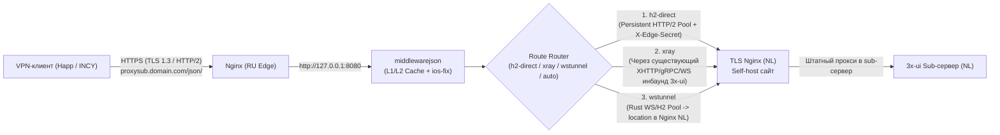

# План развития `middlewarejson`: Edge-CDN прокси подписок 3x-ui (RU Edge $\rightarrow$ NL Origin)

Этот документ содержит полный архитектурный и технический план модернизации проекта `middlewarejson` в полноценный Edge-CDN прокси с поддержкой **3 вариантов магистрального транспорта** (`h2-direct`, `xray`, `wstunnel`), умного автовыбора маршрута по минимальному пингу (`auto`), двухуровневого кэша (`TTL` + `Stale-If-Error`) и CLI-бенчмарка.

---

## 1. Контекст, существующая инфраструктура Origin и задача

- **Origin (NL):** На сервере **уже развернута боевая панель 3x-ui** с настроенными пользовательскими инбаундами, аутбаундами (включая `direct`, `blocked`, WARP/кастомные маршруты), правилами маршрутизации и sub-сервером. Перед 3x-ui стоит собственный **TLS Nginx** (self-hosted маскировочный сайт) с маршрутизацией инбаундов по путям (`XHTTP`, `gRPC`, `WebSocket`). Домен: `sub.domain.com`.
- **Edge (RU):** Российский сервер (`proxysub.domain.com`), принимающий запросы от VPN-клиентов (Happ, V2RayTun, Hiddify, INCY) с минимальным внутрироссийским пингом (5–15 мс).
- **Цель:** Проксировать запросы подписок (`/json/<sub_id>` и base64) с RU-сервера на NL-сервер по максимально быстрому и защищённому от ТСПУ маршруту, **не ломая и не требуя перенастройки существующих инбаундов/аутбаундов на 3x-ui Origin**, применяя на лету трансформации `ios-fix` / `ios-fix-dns` / `passthrough` и кэшируя ответы.

---

## 2. Важные нюансы интеграции с уже настроенным 3x-ui на Origin (NL)

Поскольку на Origin-сервере в 3x-ui уже настроены боевые инбаунды, аутбаунды и правила роутинга, архитектура учитывает **3 критических момента**:

1. **Никакого вмешательства в существующие инбаунды/аутбаунды на NL:**
   - Для маршрута `2. xray` на RU-сервере мы можем использовать **обычного клиента внутри любого уже существующего на NL инбаунда** (`XHTTP`, `gRPC` или `WebSocket`), просто создав в панели 3x-ui отдельного служебного клиента (например, `edge-relay-ru`) без лимита трафика.
2. **Обход стандартной блокировки `geoip:private` (`127.0.0.1`) в аутбаундах 3x-ui:**
   - В 3x-ui по умолчанию настроено правило маршрутизации: трафик к `geoip:private` (`127.0.0.0/8`, `10.0.0.0/8` и т.д.) направляется в аутбаунд `blocked` (`blackhole`), чтобы клиенты VPN не могли сканировать локальные порты самого сервера.
   - **Следствие:** если клиент Xray с RU-сервера попытается через штатный инбаунд 3x-ui обратиться к `http://127.0.0.1:<sub_port>`, 3x-ui заблокирует этот запрос правилом `geoip:private -> blocked`.
   - **Решение по умолчанию (Zero-Touch на NL):** При работе через `XRAY_PROXY_URL=socks5://127.0.0.1:1080` скрипт на RU обращается к публичному URL `UPSTREAM_BASE_URL` (`https://sub.domain.com/json/<sub_id>`). Тогда на стороне NL Xray выводит этот запрос через штатный аутбаунд `direct` (`freedom`) на внешний IP/интерфейс своего же Nginx (локально внутри дата-центра NL за `~0.2 мс`), **вообще не задевая правило `geoip:private` и не требуя правки роутинга в 3x-ui!**
   - **Опциональное решение (если нужно ходить строго в `127.0.0.1:<sub_port>` без TLS):** В плане и документации (`deploy/`) приводится опциональное правило для раздела `Routing` в 3x-ui: поставить выше `geoip:private` правило `User: [edge-relay-ru] -> Outbound: direct`.
3. **Учёт кастомных аутбаундов на NL (если весь трафик инбаунда завернут в сторонний прокси/WARP):**
   - Если на NL-сервере дефолтный аутбаунд в 3x-ui ведет не в `direct`, а во внешний прокси/балансировщик, то при обращении через `xray`-туннель к `sub.domain.com` запрос выйдет через внешний IP этого аутбаунда (или по правилу `domain: sub.domain.com -> direct`). В шаблонах `deploy/` это подробно описано.

---

## 3. Архитектура и 3 варианта транспорта



### Сравнение 3 реализуемых маршрутов (Москва $\leftrightarrow$ Амстердам, физический RTT ~38–40 мс)

| Характеристика | 1. `h2-direct` (HTTP/2 Keep-Alive Pool) | 2. `xray` (`XHTTP` / `gRPC` / `WS` через Nginx) | 3. `wstunnel` (Rust WS/H2 Pool через Nginx) |
| :--- | :--- | :--- | :--- |
| **Пинг на прогретом пуле (`MISS`)** | **~38–42 мс** (`1 RTT`) | **~41–46 мс** (`1 RTT` внутри мультиплексора) | **~40–44 мс** (`1 RTT` по пулу WS) |
| **Пинг из кэша на RU (`HIT`)** | **< 1.5 мс** | **< 1.5 мс** | **< 1.5 мс** |
| **Что нужно на RU-сервере** | Только `middlewarejson` | `middlewarejson` + клиент `xray-core` | `middlewarejson` + бинарник `wstunnel` |
| **Что нужно менять в 3x-ui на NL** | **Ничего (0 изменений)** | **Только добавить 1 клиента** в уже существующий инбаунд (`XHTTP`/`gRPC`/`WS`) | **Ничего в 3x-ui** (только `wstunnel server` + `location` в Nginx) |
| **Устойчивость к ТСПУ (DPI)** | Высокая (честный TLS 1.3 / HTTP/2 к вашему сайту с 1 IP) | **Максимальная** (штатный VPN-транспорт по путям сайта) | **Максимальная** (WebSocket внутри TLS вашего сайта) |
| **Безопасность** | Защита `X-Edge-Secret` на Nginx NL | Трафик внутри шифрованного VLESS-канала | Порт подписки на NL закрыт на `127.0.0.1` |

---

## 4. Детальный план доработки модулей

### Этап 1. Зависимости и конфигурация (`requirements.txt`, `.env.example`, `app/config.py`)

1. **Обновить `requirements.txt`:**
   - Заменить `httpx>=0.28.0` на `httpx[http2,socks]>=0.28.0` (добавляет `h2` для мультиплексирования HTTP/2 и `socksio` для работы с SOCKS5-портом Xray).
2. **Расширить `.env.example` и `Settings` в `app/config.py`:**
   ```env
   # --- Режим выбора маршрута: h2-direct | xray | wstunnel | auto ---
   ROUTE_MODE=auto

   # --- 1. Маршрут h2-direct (Прямой HTTP/2 Keep-Alive пул в TLS Nginx NL) ---
   UPSTREAM_BASE_URL=https://sub.domain.com
   UPSTREAM_JSON_PATH=/json
   UPSTREAM_VERIFY_SSL=true
   UPSTREAM_HOST_HEADER=
   UPSTREAM_SECRET_HEADER_NAME=X-Edge-Secret
   UPSTREAM_SECRET_HEADER_VALUE=

   # --- 2. Маршрут xray (через существующий на NL инбаунд XHTTP / gRPC / WS) ---
   # Вариант А (Zero-Touch для роутинга 3x-ui): SOCKS5-порт Xray на RU, запрос идет на UPSTREAM_BASE_URL
   XRAY_PROXY_URL=socks5://127.0.0.1:1080
   # Вариант Б (если в роутинге 3x-ui разрешен localhost или настроен dokodemo-door):
   XRAY_UPSTREAM_URL=

   # --- 3. Маршрут wstunnel (локальный порт wstunnel -> 127.0.0.1:<sub_port> на NL) ---
   WSTUNNEL_UPSTREAM_URL=http://127.0.0.1:18080
   WSTUNNEL_PROXY_URL=

   # --- Таймауты и фоновый прогрев маршрутов ---
   REQUEST_TIMEOUT_SEC=10
   ROUTE_FAILOVER_TIMEOUT_SEC=3.5
   ROUTE_PROBE_INTERVAL_SEC=30

   # --- Edge-кэш подписок (CDN) ---
   CACHE_TTL_SEC=60
   CACHE_STALE_TTL_SEC=86400
   NEGATIVE_CACHE_TTL_SEC=15
   ```

---

### Этап 2. Транспортное ядро и `Smart Route Selector` (`app/services/router.py`, `app/services/upstream.py`)

1. **Класс `RouteEndpoint` (один на каждый настроенный маршрут: `h2-direct`, `xray`, `wstunnel`):**
   - Держит **постоянный экземпляр `httpx.AsyncClient`**:
     - `http2=True`
     - `limits=httpx.Limits(max_keepalive_connections=20, max_connections=100, keepalive_expiry=120.0)`
     - `proxy=...` (для `xray` / `wstunnel` в режиме SOCKS5)
   - Хранит живую телеметрию маршрута:
     - `ewma_latency_ms: float | None` — экспоненциальное скользящее среднее времени ответа (`0.7 * old + 0.3 * sample`).
     - `last_latency_ms: float | None`
     - `consecutive_failures: int`
     - `healthy: bool`
     - `cooldown_until: float` — карантин (circuit breaker на 15–30 сек после 2 ошибок подряд).

2. **Класс `SmartRouteManager`:**
   - Инициализирует все сконфигурированные маршруты в `lifespan` приложения FastAPI и корректно закрывает их при остановке.
   - **Фоновый прогрев и пинг (`_probe_loop`)**:
     - Каждые `ROUTE_PROBE_INTERVAL_SEC` (30 сек) отправляет легкий запрос по каждому маршруту.
     - Это решает две задачи: **сокет TCP + TLS + HTTP/2 (и сессия XHTTP/gRPC/WS) никогда не закрывается по таймауту** (клиент всегда попадает в прогретое соединение за 1 RTT) и обновляется `ewma_latency_ms`.
   - **Выбор маршрута при запросе клиента:**
     - Если `route_mode` = конкретный маршрут (`h2-direct`, `xray` или `wstunnel`), пытается выполнить запрос через него, а при сетевой ошибке (если доступны другие маршруты) делает автоматический fallback.
     - Если `route_mode == "auto"`, сортирует здоровые маршруты по возрастанию `ewma_latency_ms` и идет через самый быстрый. При таймауте (`ROUTE_FAILOVER_TIMEOUT_SEC`) мгновенно переключается на следующий маршрут в очереди.

3. **Сохранение заголовков 3x-ui и диагностика:**
   - Прозрачный проброс `Subscription-Userinfo`, `Profile-Update-Interval`, `Profile-Title`, `Support-Url`, `Profile-Web-Page-Url`, `Announce`, `Routing`, `Routing-Enable`.
   - Добавление в ответ заголовков:
     - `X-Proxy-Route: <name> (<latency>ms)`
     - `X-Proxy-Cache: HIT | MISS | STALE`

---

### Этап 3. Двухуровневый кэш подписок (`app/services/cache.py` + `app/db/schema.py`)

1. **Схема таблицы `subscription_cache` в SQLite (`data/middleware.db`):**
   - Поля: `cache_key TEXT PRIMARY KEY`, `sub_id TEXT`, `transform_mode TEXT`, `status_code INTEGER`, `body TEXT`, `headers_json TEXT`, `route_name TEXT`, `fetched_at REAL`.
2. **Логика работы кэша:**
   - **L1 (In-Memory словарь с LRU-ограничением на 2000 записей)** + **L2 (SQLite)**.
   - **Fresh Hit (`now - fetched_at <= CACHE_TTL_SEC`)**: мгновенная отдача готового (уже трансформированного) ответа за `< 1 мс` без обращения к NL.
   - **Negative Cache (`status_code == 404`, `TTL = 15s`)**: защита туннеля и Origin-сервера от перебора несуществующих `sub_id`.
   - **Singleflight (`asyncio.Lock` на `cache_key`)**: если клиент шлет несколько одинаковых запросов параллельно, на NL уходит только один запрос.
   - **Stale-If-Error (`now - fetched_at <= CACHE_STALE_TTL_SEC`)**: если все маршруты до NL недоступны или Origin перезагружается, возвращается последняя сохраненная в L1/L2 рабочая подписка со статусом `200` и заголовком `X-Proxy-Cache: STALE` вместо ошибки `502`.

---

### Этап 4. Обновление роутов и `/health` (`app/routes/subscription.py`)

1. В `GET / HEAD <json_path>/{sub_id}`:
   - Валидация `sub_id` (`^[a-zA-Z0-9_-]{8,64}$`).
   - Проверка `Fresh Cache` $\rightarrow$ при `MISS` запрос через `SmartRouteManager` $\rightarrow$ трансформация (`ios-fix` / `ios-fix-dns` / `passthrough`) $\rightarrow$ запись в кэш.
   - При `UpstreamError` $\rightarrow$ попытка отдать `STALE` из кэша, иначе `502`.
2. В `GET /health`:
   - Возвращать статус сервиса, текущий `transform_mode`, `route_mode`, список активных маршрутов с их `ewma_latency_ms` и `healthy`, а также статистику кэша (`hits`, `misses`, `stale_hits`).

---

### Этап 5. Расширение CLI и встроенный бенчмарк (`app/cli.py`, `app/cli_ops.py`)

1. **Управление режимом маршрутизации без перезапуска:**
   - `python -m app.cli settings route-mode <h2-direct|xray|wstunnel|auto>` (хранится в таблице `settings` в `data/middleware.db`, как и `transform_mode`).
2. **Интерактивный и консольный бенчмарк всех 3 транспортов:**
   - Команда `python -m app.cli benchmark [sub_id]` (и новый пункт в интерактивном меню CLI).
   - Для каждого настроенного маршрута (`h2-direct`, `xray`, `wstunnel`) выполняет:
     - 1 холодный запрос (новое соединение) — замер времени TCP+TLS handshake + HTTP.
     - 5 последовательных прогретых запросов (`Keep-Alive`) — замер чистого RTT, минимума, максимума и джиттера.
   - Выводит таблицу Rich в консоль и подсказывает самый быстрый маршрут.

---

### Этап 6. Готовые шаблоны деплоя под все 3 транспорта (`deploy/`)

1. **`deploy/nginx-ru-edge.conf.example`**:
   - Конфиг Nginx для `proxysub.domain.com` (TLS 1.3, HTTP/2, `proxy_pass http://127.0.0.1:8080`, `limit_req_zone` от флуда).
2. **`deploy/nginx-nl-origin.conf.example`**:
   - Фрагмент для вашего существующего TLS Nginx на NL:
     - Опциональная защита `/json/` по заголовку `X-Edge-Secret` (для варианта 1 `h2-direct`).
     - Скрытый `location /<secret-ws-path>` для `wstunnel` (для варианта 3).
3. **`deploy/xray-ru-client.json.example`**:
   - Готовый клиентский конфиг `xray-core` для RU-сервера, который подключается к **уже существующему инбаунду на вашем 3x-ui (NL)** по одному из 3 ваших транспортов (**`XHTTP` с `xmux` keep-alive**, **`gRPC`**, **`WebSocket`** поверх TLS Nginx на NL) и открывает локальный `socks5` на `127.0.0.1:1080`.
   - Памятка по настройке клиента в существующем 3x-ui без конфликта с `geoip:private` и существующими аутбаундами.
4. **`deploy/wstunnel-ru-client.service` и `deploy/wstunnel-nl-server.service`**:
   - Systemd-юниты для `wstunnel` с параметром `--connection-min-idle 4` (постоянный прогретый пул WebSocket/HTTP2 соединений).

---

### Этап 7. Тестирование (`tests/`)

- `tests/test_router.py`:
  - Выбор маршрута с минимальным `ewma_latency_ms` в режиме `auto`.
  - Мгновенный failover с `h2-direct` на `xray` / `wstunnel` при таймауте или ошибке 5xx.
  - Переключение `route_mode` через БД без рестарта.
- `tests/test_cache.py`:
  - Отдача из `Fresh Cache` (`X-Proxy-Cache: HIT`).
  - Отдача из `Stale-If-Error` (`X-Proxy-Cache: STALE`) при полном падении всех апстримов.
  - Работа `Negative Cache` для `404` и `Singleflight` при параллельных запросах.
- Сохранение 100% прохождения всех 54 существующих тестов `middlewarejson`.
